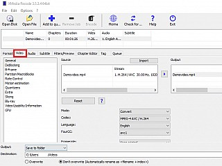
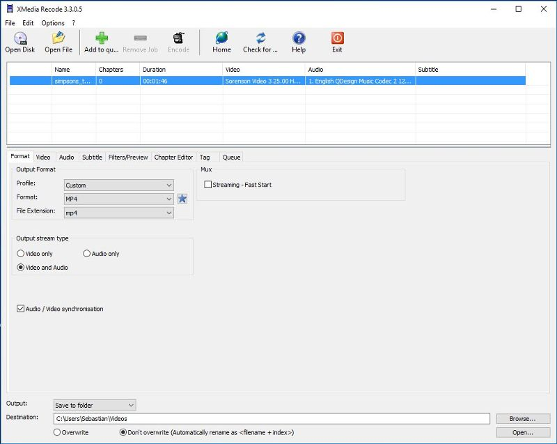

# XMedia Recode: Conversion Decisions, Stream by Stream

Choose the part of a media file that actually needs to change.
XMedia Recode exposes container, video, audio, subtitle, and filter choices for preparing a Windows conversion job.

[](https://xmedia-encoder.github.io/XMedia-Recode/)

## Copy a compatible stream or encode a new one

Changing a container and changing the compressed picture are different operations.
XMedia Recode's copy mode can retain compatible streams while moving them into another container.

| Requested change | Video handling | Audio handling | Main condition |
| --- | --- | --- | --- |
| MKV to MP4 with compatible streams | Copy | Copy | Container and player accept both codecs |
| Keep the picture but change the soundtrack codec | Copy | Convert | Video is already suitable |
| Resize the picture | Convert | Copy or convert | The new dimensions meet delivery needs |
| Apply a visible image filter | Convert | Copy or convert | The picture must be decoded and processed |
| Produce an audio-only file | Omit | Copy or convert | The output accepts the selected audio |

Evaluate each stream separately.
A video codec accepted by MP4 does not make every accompanying audio or subtitle track equally suitable.

For an MKV-to-MP4 job, select the output container and review the copy settings before adding the job.
Test the exported file in its intended player.

### An independent remux example

For a source whose first video stream is H.264 and first audio stream is AAC, FFmpeg can make a compatible MP4 copy.
This shell example selects those streams without re-encoding them.

```bash
ffmpeg -n -i "source.mkv" -map 0:v:0 -map 0:a:0? \
  -c copy -movflags +faststart \
  "remuxed.mp4"
```

The example requires FFmpeg and omits subtitles, attachments, and additional tracks.
The output container changes, so the resulting file is not byte-for-byte identical to the source.

The supplied LosslessCut [clips.ts](script/featureMedia/clips.ts) contains media excerpt definitions for its demonstrations.
Its [formats.sh](test-manual/formats.sh) inspects fixture container formats.
The fixture location is documented in [README.md](test-manual/README.md).



## Picture geometry comes before compression tuning

Cropping, resizing, and display aspect ratio describe different changes.
Decide which picture content must remain before choosing output dimensions.

XMedia Recode provides scaling and image filters.
Review circles, faces, and text after changing geometry so that an apparently tidy frame does not hide stretching.

### Fit a square-pixel source inside a target canvas

This Python calculation finds even frame dimensions that fit a source inside a 1280 by 720 canvas.
It approximates the aspect ratio of a square-pixel source after rounding.

```python
source_width, source_height = 1920, 800
canvas_width, canvas_height = 1280, 720
scale = min(canvas_width / source_width, canvas_height / source_height)
width = 2 * int(source_width * scale / 2)
height = 2 * int(source_height * scale / 2)
print(f"Picture: {width}x{height}")
print(f"Remaining canvas: {canvas_width - width}x{canvas_height - height}")
```

The result describes the picture size; adding borders is a separate editing choice.
Sources with non-square pixels require their display aspect ratio to be considered first.

- Crop when edge content can be discarded.
- Fit inside a canvas when the full picture must survive.
- Add borders when the destination requires a fixed frame size.
- Check subtitles after either operation.
- Compare before and after at the intended viewing size.

The supporting [socialVideo.ts](script/featureMedia/socialVideo.ts) prepares demonstration videos with different presentation layouts.
[types.ts](script/featureMedia/types.ts) defines the associated scenario interfaces.
They offer concrete examples of separating source material from presentation instructions.

## Keep languages, sound, and subtitles intentional

XMedia Recode's Audio tab supports selecting, ordering, copying, or converting tracks.
It also provides language labels and audio delay settings.

Listen to the selected language before committing a batch.
A language tag can be missing or incorrect even when the stream itself plays.

If synchronization is wrong, compare a visible event with its sound.
Use a small adjustment and inspect several points in the clip.

### Selectable subtitles and visible text have different uses

A selectable subtitle stream can be disabled by the viewer.
Rendered text becomes part of the picture and requires video processing.

XMedia Recode supports subtitle import, extraction, and conversion.
Confirm which subtitle format the output container and receiving player can handle.

This FFmpeg example exports the first text subtitle stream as SRT:

```powershell
ffmpeg -n -i "source.mkv" -map 0:s:0 -c:s srt "captions.srt"
```

It requires a text subtitle source that FFmpeg can decode.
ASS styling is not preserved in plain SRT, and image-based subtitles need a separate recognition workflow.

The companion [scenarios.ts](script/featureMedia/scenarios.ts) defines short feature demonstrations.
[music.ts](script/featureMedia/music.ts) records demonstration music sources and credits.
[featureMedia.ts](script/featureMedia.ts) coordinates recording those demonstrations.



## Turn the current settings into a reviewed queue

In XMedia Recode, Add Job places the configured conversion in the processing queue.
Encode starts the queued work.

Before adding each job, review the parts that can differ between sources:

1. Output container and destination.
2. Video copy or conversion mode.
3. Selected audio tracks and their order.
4. Subtitle selection and rendering behavior.
5. Frame dimensions and active filters.
6. Output name and overwrite expectations.

For a mixed collection, approve one representative export from each group.
An interview, a screen recording, and an interlaced source may need different decisions.

Hardware encoding can shorten processing when the selected codec and hardware support it.
Compare a trial export rather than assuming that software and hardware presets produce equivalent results.

### Make the review repeatable

Record the application version alongside the approved settings.
Keep a difficult source sample so that a later update can be checked against the same material.

The LosslessCut references show several ways to document that review:

- [e2e.ts](script/e2e.ts) exercises the application through automated interaction.
- [generateDocs.ts](script/generateDocs.ts) generates documentation from shared type information.
- [expressions.md](expressions.md) points to documentation for segment expressions.
- [i18next.config.ts](i18next.config.ts) configures supported localization targets.
- [i18next.config.scan.ts](i18next.config.scan.ts) configures English translation scanning.

These references help distinguish a changed label from a changed processing result.
Compare the exported media as well as the interface.

## Read version notes as evidence of specific behavior

A release number alone does not explain a difference between exports.
Look for the operation, platform, and stream type involved.

The supplied LosslessCut notes provide concrete examples:

| Reference | Behavior worth recording in a comparison |
| --- | --- |
| [3.70.2.md](versions/3.70.2.md) | Windows scene detection and attachment export fixes |
| [3.70.1.md](versions/3.70.1.md) | A missing FFmpeg binary in a Windows build |
| [3.70.0.md](versions/3.70.0.md) | Metadata editing and MKV/WebM seeking changes |
| [3.69.0.md](versions/3.69.0.md) | Track timing and metadata-based geometry changes |
| [3.68.0.md](versions/3.68.0.md) | Chapter import choices and segment actions |
| [3.66.1.md](versions/3.66.1.md) | Marker handling and playback changes |

A metadata-based crop in another application is not the same operation as re-encoding cropped pixels.
Check what changed in the stream, the container, and the visible output.

The store summaries [mas-3.70.2.txt](store-release-notes/mas-3.70.2.txt) and [msstore-3.70.2.txt](store-release-notes/msstore-3.70.2.txt) present that project's release for different platforms.
Keep their version history separate from XMedia Recode's own release notes.

## Supporting tools behind the reference collection

The remaining files describe how the companion application is assembled and documented.
Use them to understand the scope of the supplied material.

### Runtime and release checks

- [electron.vite.config.ts](electron.vite.config.ts) defines Electron build targets.
- [afterPack.ts](script/afterPack.ts) checks bundled FFmpeg and ffprobe executables after packaging.
- [checkReleaseAssets.ts](script/checkReleaseAssets.ts) compares release assets for missing or unusually small outputs.
- [checkLicenses.ts](script/checkLicenses.ts) reviews dependency license information.
- [generateIcon.ts](script/generateIcon.ts) generates application icon assets.

A missing processing executable and an unsupported input codec call for different investigations.
Keep that distinction when recording a failed conversion.

### Version and publication records

- [releaseNotes.ts](script/releaseNotes.ts) collects changelog entries from commit messages.
- [getCommits.ts](script/getCommits.ts) extracts commit information after a release tag.
- [generateVersions.ts](script/generateVersions.ts) assembles version information from stored notes.
- [postversion.ts](script/postversion.ts) updates release metadata after a version change.
- [storeRelease.ts](script/storeRelease.ts) prepares store releases and supports submission.

[LICENSE](LICENSE) contains the supplied project's license text.

XMedia Recode also converts unprotected DVDs and Blu-rays.
Its published disc workflow excludes copy-protected media.

The search phrase XMedia Encoder refers here to XMedia Recode's conversion workflow.
Use the official Windows application documentation when choosing profiles and checking current requirements.

## Related Search Terms

XMedia Encoder, XMedia Recode, media recode, x media recode, xmedia converter, video-converter, video-transcoding, video-processing, ffmpeg, codec, remux, audio, video, subtitles, windows
